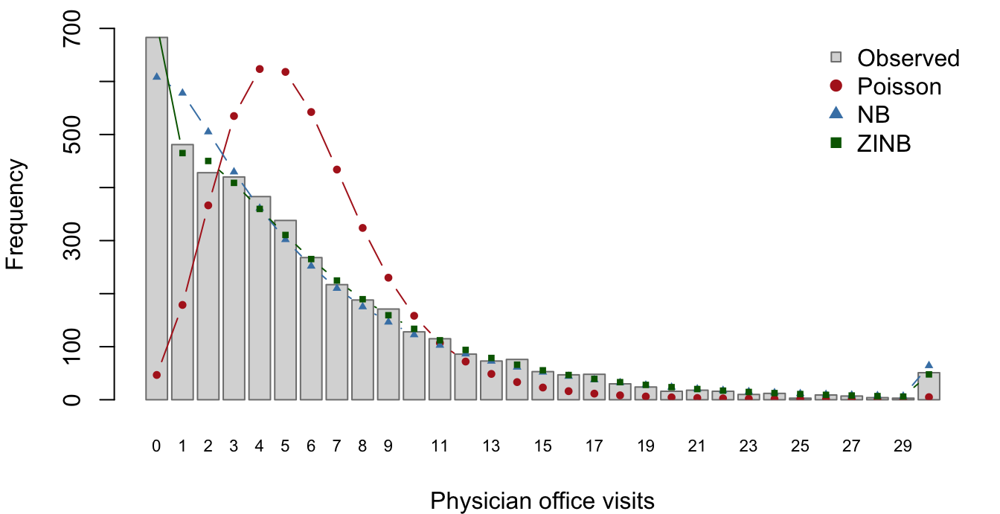

# Negative Binomial and Zero-Inflated Negative Binomial Regression from Scratch: the nbzinbCirkovic Package

## 1 Introduction

Count outcomes, such as the number of physician visits or the number of
published articles, are often modelled with Poisson regression. The
Poisson model forces the variance to equal the mean. Real count data
usually violate this in two ways: the variance is much larger than the
mean (**overdispersion**), and there are more zeros than a Poisson
distribution with the same mean would produce (**excess zeros**).
Ignoring overdispersion makes standard errors too small and tests
anti-conservative.

The negative binomial (NB) model adds a dispersion parameter $`\theta`$
that lets the variance exceed the mean. The zero-inflated negative
binomial (ZINB) model goes further and treats the data as a mixture of a
group that always produces zeros and a group that follows an NB
distribution.

The goal of this project is an R package, **nbzinbCirkovic**, that fits
both models *without* any general-purpose optimizer. NB regression is
fitted by iteratively reweighted least squares (IRLS) alternated with
Newton–Raphson for $`\log\theta`$, and ZINB regression by an EM
algorithm whose M-steps are IRLS fits. We show that the package
reproduces [`MASS::glm.nb()`](https://rdrr.io/pkg/MASS/man/glm.nb.html)
and [`pscl::zeroinfl()`](https://rdrr.io/pkg/pscl/man/zeroinfl.html),
check by simulation that
[`zinbreg()`](https://cirkovicdavid.github.io/nbzinbCirkovic/reference/zinbreg.md)
recovers known parameters, and use it to analyze physician office visits
in the NMES1988 data.

## 2 Methods

### 2.1 The negative binomial model

Let $`Y_i`$ be a count with covariate vector $`x_i`$,
$`i = 1, \dots, n`$. The NB2 model is
``` math
P(Y_i = y) = \frac{\Gamma(y + \theta)}{\Gamma(\theta)\, y!}
\left(\frac{\theta}{\theta + \mu_i}\right)^{\theta}
\left(\frac{\mu_i}{\theta + \mu_i}\right)^{y}, \qquad
\log \mu_i = \eta_i = x_i^\top \beta + o_i,
```
with optional offset $`o_i`$. Then $`E(Y_i) = \mu_i`$ and
$`\operatorname{Var}(Y_i) = \mu_i + \mu_i^2/\theta`$; as
$`\theta \to \infty`$ the model reduces to the Poisson. With prior
weights $`a_i`$ the log-likelihood is
``` math
\ell(\beta, \theta) = \sum_i a_i \Big[\log\Gamma(y_i + \theta) - \log\Gamma(\theta)
- \log y_i! + \theta \log\theta + y_i \log\mu_i - (\theta + y_i)\log(\theta + \mu_i)\Big].
```

**IRLS for $`\beta`$ ($`\theta`$ fixed).** For fixed $`\theta`$ the NB
is an exponential-family GLM with variance function
$`V(\mu) = \mu + \mu^2/\theta`$. Fisher scoring is equivalent to
repeated weighted least squares with
``` math
w_i = a_i \frac{(\partial\mu_i/\partial\eta_i)^2}{V(\mu_i)} = a_i\frac{\theta\mu_i}{\theta + \mu_i},
\qquad z_i = (\eta_i - o_i) + \frac{y_i - \mu_i}{\mu_i},
\qquad \beta^{(t+1)} = (X^\top W X)^{-1} X^\top W z .
```
The weighted least-squares step is solved with a QR decomposition of
$`W^{1/2}X`$, and iterations stop when
$`\max_j|\beta_j^{(t+1)} - \beta_j^{(t)}| < 10^{-8}`$.

**Newton–Raphson for $`\theta`$ ($`\beta`$ fixed).** The score and
second derivative are
``` math
U(\theta) = \sum_i a_i\Big[\psi(y_i+\theta) - \psi(\theta) + \log\theta + 1 - \log(\theta+\mu_i) - \frac{y_i+\theta}{\theta+\mu_i}\Big],
```
``` math
H(\theta) = \sum_i a_i\Big[\psi'(y_i+\theta) - \psi'(\theta) + \frac1\theta - \frac{2}{\theta+\mu_i} + \frac{y_i+\theta}{(\theta+\mu_i)^2}\Big].
```
We update $`\phi = \log\theta`$, which keeps $`\theta > 0`$: with
$`U_\phi = \theta U`$ and $`H_\phi = \theta^2 H + \theta U`$,
$`\phi \leftarrow \phi - U_\phi/H_\phi`$. Each step is halved until the
log-likelihood does not decrease. In the code, $`U`$ and $`H`$ are
evaluated in an algebraically equivalent form (for example
$`\log\theta - \log(\theta+\mu) =
-\log(1+\mu/\theta)`$) that avoids cancellation when $`\theta`$ is
large.

**Outer loop and standard errors.** Starting from a Poisson IRLS fit and
the moment estimate $`\theta_0 = n / \sum_i (y_i/\mu_i - 1)^2`$, the two
updates are alternated until the log-likelihood changes by less than
$`10^{-8}`$. At convergence
$`\widehat{\operatorname{Var}}(\hat\beta) = (X^\top \hat W X)^{-1}`$,
treating $`\theta`$ as known as `glm.nb()` does (this is justified
because $`\beta`$ and $`\theta`$ are orthogonal:
$`E[\partial^2\ell/\partial\beta\,\partial\theta] = 0`$), and
$`\operatorname{SE}(\hat\theta) = \{-H(\hat\theta)\}^{-1/2}`$.

### 2.2 The zero-inflated negative binomial model

With probability $`\pi_i`$ observation $`i`$ is a structural zero;
otherwise it is NB$`(\mu_i, \theta)`$:
``` math
P(Y_i = 0) = \pi_i + (1-\pi_i) f_{NB}(0;\mu_i,\theta), \qquad
P(Y_i = y) = (1-\pi_i) f_{NB}(y;\mu_i,\theta),\ y \ge 1,
```
with $`f_{NB}(0;\mu,\theta) = \{\theta/(\theta+\mu)\}^\theta`$,
$`\log\mu_i = x_i^\top\beta + o_i`$ and
$`\operatorname{logit}\pi_i = z_i^\top\gamma`$. The marginal mean is
$`E(Y_i) = (1-\pi_i)\mu_i`$. The observed-data log-likelihood
``` math
\ell(\beta,\gamma,\theta) = \sum_{y_i = 0}\log\{\pi_i + (1-\pi_i)f_{NB}(0;\mu_i,\theta)\}
+ \sum_{y_i>0}\{\log(1-\pi_i) + \log f_{NB}(y_i;\mu_i,\theta)\}
```
contains the logarithm of a sum, so it is not an exponential-family
likelihood and cannot be maximized by IRLS directly.

**EM algorithm.** Let $`D_i = 1`$ if observation $`i`$ is a structural
zero. If the $`D_i`$ were known, the complete-data log-likelihood would
split into a logistic-regression part in $`\gamma`$ and a weighted NB
part in $`(\beta,\theta)`$. EM replaces $`D_i`$ by its conditional
expectation.

- *E-step:*
  $`\tau_i = P(D_i = 1\mid y_i) = \pi_i / \{\pi_i + (1-\pi_i) f_{NB}(0;\mu_i,\theta)\}`$
  if $`y_i = 0`$, and $`\tau_i = 0`$ if $`y_i > 0`$.
- *M-step, zero part:* maximize
  $`\sum_i \tau_i\log\pi_i + (1-\tau_i)\log(1-\pi_i)`$, a logistic
  regression with fractional response, by IRLS with
  $`w_i = \pi_i(1-\pi_i)`$ and
  $`z_i = z_i^\top\gamma + (\tau_i - \pi_i)/\{\pi_i(1-\pi_i)\}`$.
- *M-step, count part:* maximize
  $`\sum_i (1-\tau_i)\log f_{NB}(y_i;\mu_i,\theta)`$, which is exactly
  the NB fit above with prior weights $`a_i = 1 - \tau_i`$.

Both M-steps are iterated to convergence, so each EM iteration cannot
decrease $`\ell`$; the package records $`\ell`$ at every iteration and
warns if it ever decreases. Starting values are the NB fit for
$`(\beta,\theta)`$ and a logistic IRLS fit of $`I(y_i = 0)`$ on $`z_i`$
for $`\gamma`$. EM stops when $`\ell`$ changes by less than $`10^{-8}`$.

**Standard errors.** EM does not provide an information matrix, so we
invert the observed information $`-\nabla^2\ell`$ with respect to
$`(\beta, \gamma, \log\theta)`$ at the estimates. The Hessian is
computed **analytically**. Because $`\ell_i`$ depends on $`\beta`$ only
through $`\eta_i = x_i^\top\beta + o_i`$ and on $`\gamma`$ only through
$`\zeta_i = z_i^\top\gamma`$, every block is a weighted cross-product,
e.g.
$`\partial^2\ell/\partial\beta\,\partial\gamma^\top = X^\top \operatorname{diag}(\ell_{\eta\zeta,i}) Z`$,
and only six scalar second derivatives per observation are needed. For
$`y_i > 0`$ the zero and count parts separate, so
$`\ell_{\eta\zeta} = \ell_{\zeta\phi} = 0`$,
$`\ell_{\zeta\zeta} = -\pi_i(1-\pi_i)`$ and
$`\ell_{\eta\eta} = -\theta\mu_i(\theta+y_i)/(\theta+\mu_i)^2`$. For
$`y_i = 0`$, $`\ell_i = \log L_i`$ with $`L_i = \pi_i + (1-\pi_i)f_0`$
and $`\ell_{ab} = L_{ab}/L - L_a L_b / L^2`$. The analytic Hessian
agrees with a numerical Hessian (`numDeriv`) to a relative error below
$`10^{-6}`$ (tested in the package). $`\operatorname{SE}(\hat\theta)`$
follows from the delta method,
$`\hat\theta\,\operatorname{SE}(\log\hat\theta)`$.

## 3 The R package

The package exports two fitting functions and their control functions:

- `nbreg(formula, data, offset, control = nbreg_control())`
- `zinbreg(formula, data, offset, control = zinbreg_control())`, with a
  two-part formula `y ~ x1 + x2 | z1 + z2` (count covariates before `|`,
  zero-model covariates after; without `|` both parts use the same
  covariates).

Internally, `R/irls.R` holds the IRLS and Newton–Raphson building
blocks, `nb_fit()` the NB outer loop (reused, with weights $`1-\tau_i`$,
as the ZINB count M-step), `zinb_fit()` the EM loop, and `R/hessian.R`
the analytic derivatives. Both functions return S3 objects (`"nbreg"`,
`"zinbreg"`) with methods `print`, `summary`, `coef`, `vcov`, `logLik`
(with a `df` attribute, so [`AIC()`](https://rdrr.io/r/stats/AIC.html)
and [`BIC()`](https://rdrr.io/r/stats/AIC.html) work), `fitted`,
`residuals` (response and Pearson), `nobs` and `predict` (with
`newdata`; for `zinbreg`, `type = "response"`, `"count"` or `"zero"`).
The control functions set tolerances, iteration limits and a `trace`
option; the fitting functions warn when the algorithm does not converge
or when $`\hat\theta`$ is very large (the Poisson limit).

The package has roxygen2 documentation with runnable examples, four
testthat files that compare it with `glm.nb()` and `zeroinfl()` and
check offsets, single-covariate models, error messages and the monotone
EM log-likelihood, and a GitHub Actions workflow running `R CMD check`
on Linux, macOS and Windows. Installation and a short example:

``` r

# install.packages("devtools")
devtools::install_github("cirkovicdavid/nbzinbCirkovic")
library(nbzinbCirkovic)
fit <- zinbreg(art ~ fem + mar + kid5 + phd + ment | ment, data = bioChemists)
summary(fit)
predict(fit, newdata = bioChemists[1:3, ], type = "zero")
```

## 4 Benchmarking

We fitted both models to
[`pscl::bioChemists`](https://rdrr.io/pkg/pscl/man/bioChemists.html)
(art ~ fem + mar + kid5 + phd + ment, all covariates in both ZINB parts)
and [`AER::NMES1988`](https://rdrr.io/pkg/AER/man/NMES1988.html) (the
specification of Section 6) with our package and with the reference
functions, run with tight tolerances (`glm.control(epsilon = 1e-10)`,
`zeroinfl.control(reltol = 1e-12)`). Tables 1–4 show the estimates side
by side; Table 5 summarizes the maximum absolute differences against the
required tolerances.

| Term        |     Ours | Reference | SE ours | SE ref. | \|diff\| est. | \|diff\| SE |
|:------------|---------:|----------:|--------:|--------:|--------------:|------------:|
| (Intercept) |  0.25614 |   0.25614 | 0.13735 | 0.13735 |       8.1e-10 |     5.2e-10 |
| femWomen    | -0.21642 |  -0.21642 | 0.07264 | 0.07264 |       1.6e-10 |     2.7e-10 |
| marMarried  |  0.15049 |   0.15049 | 0.08210 | 0.08210 |       6.5e-11 |     3.1e-10 |
| kid5        | -0.17642 |  -0.17642 | 0.05281 | 0.05281 |       1.3e-10 |     1.9e-10 |
| phd         |  0.01527 |   0.01527 | 0.03587 | 0.03587 |       5.5e-11 |     1.4e-10 |
| ment        |  0.02908 |   0.02908 | 0.00321 | 0.00321 |       5.7e-11 |     1.6e-11 |
| theta       |  2.26439 |   2.26439 | 0.27118 | 0.27118 |       4.0e-08 |     1.1e-06 |

bioChemists, NB: nbreg() vs glm.nb(). {.table .caption-top}

| Term | Ours | Reference | SE ours | SE ref. | \|diff\| est. | \|diff\| SE |
|:---|---:|---:|---:|---:|---:|---:|
| count\_(Intercept) | 0.41675 | 0.41675 | 0.14360 | 0.14360 | 2.3e-06 | 3.3e-07 |
| count_femWomen | -0.19550 | -0.19551 | 0.07559 | 0.07559 | 2.3e-06 | 1.2e-07 |
| count_marMarried | 0.09758 | 0.09758 | 0.08445 | 0.08445 | 1.3e-06 | 1.9e-08 |
| count_kid5 | -0.15173 | -0.15173 | 0.05421 | 0.05421 | 1.7e-06 | 1.3e-08 |
| count_phd | -0.00070 | -0.00070 | 0.03627 | 0.03627 | 6.5e-07 | 7.3e-08 |
| count_ment | 0.02479 | 0.02479 | 0.00349 | 0.00349 | 3.1e-07 | 2.6e-07 |
| zero\_(Intercept) | -0.19184 | -0.19169 | 1.32272 | 1.32282 | 1.5e-04 | 9.4e-05 |
| zero_femWomen | 0.63595 | 0.63593 | 0.84885 | 0.84892 | 1.2e-05 | 6.6e-05 |
| zero_marMarried | -1.49932 | -1.49947 | 0.93859 | 0.93867 | 1.5e-04 | 8.2e-05 |
| zero_kid5 | 0.62841 | 0.62843 | 0.44276 | 0.44278 | 2.1e-05 | 2.4e-05 |
| zero_phd | -0.03768 | -0.03771 | 0.30799 | 0.30801 | 3.3e-05 | 2.1e-05 |
| zero_ment | -0.88222 | -0.88229 | 0.31619 | 0.31623 | 7.6e-05 | 3.6e-05 |
| Log(theta) | 0.97637 | 0.97636 | 0.13547 | 0.13547 | 1.3e-05 | 4.3e-07 |

bioChemists, ZINB: zinbreg() vs zeroinfl(). {.table .caption-top}

| Term            |     Ours | Reference | SE ours | SE ref. | \|diff\| est. | \|diff\| SE |
|:----------------|---------:|----------:|--------:|--------:|--------------:|------------:|
| (Intercept)     |  0.92926 |   0.92926 | 0.05459 | 0.05459 |       4.7e-10 |     5.9e-12 |
| hospital        |  0.21777 |   0.21777 | 0.02018 | 0.02018 |       3.5e-10 |     2.3e-12 |
| healthpoor      |  0.30501 |   0.30501 | 0.04851 | 0.04851 |       3.1e-10 |     5.1e-12 |
| healthexcellent | -0.34181 |  -0.34181 | 0.06092 | 0.06092 |       8.9e-11 |     6.3e-12 |
| chronic         |  0.17492 |   0.17492 | 0.01209 | 0.01209 |       1.4e-10 |     1.3e-12 |
| gendermale      | -0.12649 |  -0.12649 | 0.03122 | 0.03122 |       5.7e-11 |     3.3e-12 |
| school          |  0.02682 |   0.02682 | 0.00439 | 0.00439 |       6.1e-12 |     4.7e-13 |
| insuranceyes    |  0.22440 |   0.22440 | 0.03946 | 0.03946 |       8.3e-11 |     4.3e-12 |
| theta           |  1.20660 |   1.20660 | 0.03356 | 0.03355 |       3.6e-10 |     4.2e-07 |

NMES1988, NB: nbreg() vs glm.nb(). {.table .caption-top}

| Term | Ours | Reference | SE ours | SE ref. | \|diff\| est. | \|diff\| SE |
|:---|---:|---:|---:|---:|---:|---:|
| count\_(Intercept) | 1.19372 | 1.19371 | 0.05666 | 0.05666 | 3.2e-06 | 6.5e-08 |
| count_hospital | 0.20148 | 0.20148 | 0.02036 | 0.02036 | 2.7e-08 | 1.2e-08 |
| count_healthpoor | 0.28513 | 0.28513 | 0.04509 | 0.04509 | 6.8e-08 | 4.2e-08 |
| count_healthexcellent | -0.31934 | -0.31934 | 0.06040 | 0.06040 | 6.5e-09 | 4.0e-08 |
| count_chronic | 0.12900 | 0.12900 | 0.01193 | 0.01193 | 4.5e-07 | 1.2e-08 |
| count_gendermale | -0.08028 | -0.08028 | 0.03102 | 0.03102 | 5.9e-07 | 4.1e-08 |
| count_school | 0.02142 | 0.02142 | 0.00436 | 0.00436 | 3.7e-09 | 1.6e-08 |
| count_insuranceyes | 0.12586 | 0.12586 | 0.04159 | 0.04159 | 1.6e-06 | 5.0e-08 |
| zero\_(Intercept) | -0.04689 | -0.04688 | 0.26856 | 0.26856 | 9.0e-06 | 4.6e-07 |
| zero_hospital | -0.80046 | -0.80048 | 0.42080 | 0.42082 | 2.6e-05 | 1.7e-05 |
| zero_chronic | -1.24791 | -1.24794 | 0.17831 | 0.17832 | 2.6e-05 | 6.0e-06 |
| zero_gendermale | 0.64768 | 0.64768 | 0.20011 | 0.20011 | 2.5e-06 | 3.1e-06 |
| zero_school | -0.08377 | -0.08377 | 0.02625 | 0.02625 | 1.4e-06 | 4.3e-07 |
| zero_insuranceyes | -1.17561 | -1.17562 | 0.22012 | 0.22012 | 4.6e-06 | 4.5e-06 |
| Log(theta) | 0.39415 | 0.39414 | 0.03504 | 0.03504 | 4.4e-06 | 4.0e-08 |

NMES1988, ZINB: zinbreg() vs zeroinfl(). {.table .caption-top}

| Data set    | Model | Coefficients | Std. errors |   Theta | Log-lik. | Ours (s) | Ref. (s) |
|:------------|:------|-------------:|------------:|--------:|---------:|---------:|---------:|
| bioChemists | NB    |      8.1e-10 |     5.2e-10 | 4.0e-08 |  1.4e-12 |    0.008 |    0.022 |
| bioChemists | ZINB  |      1.5e-04 |     9.4e-05 | 1.3e-05 |  4.2e-08 |    0.388 |    0.049 |
| NMES1988    | NB    |      4.7e-10 |     6.3e-12 | 3.6e-10 |  4.2e-11 |    0.035 |    0.078 |
| NMES1988    | ZINB  |      2.6e-05 |     1.7e-05 | 4.4e-06 |  1.6e-08 |    0.820 |    0.229 |

Maximum absolute differences from the reference functions (Theta: theta
for NB, log theta for ZINB) and median computing times in seconds.
Required: NB $`\le 10^{-5}`$ (coefficients, SEs) and $`\le 10^{-4}`$
($`\theta`$, log-likelihood); ZINB $`\le 10^{-3}`$ for all quantities.
{.table .caption-top}

All differences are well inside the tolerances of the assignment. The NB
fits agree with `glm.nb()` to about $`10^{-9}`$, and
[`nbreg()`](https://cirkovicdavid.github.io/nbzinbCirkovic/reference/nbreg.md)
(typically 3 outer iterations, because $`\beta`$ and $`\theta`$ are
orthogonal) is as fast as or faster than `glm.nb()`. The ZINB fits agree
with `zeroinfl()` to about $`10^{-4}`$. EM needs 111 iterations on
bioChemists and 53 on NMES1988 because it converges only linearly, so
[`zinbreg()`](https://cirkovicdavid.github.io/nbzinbCirkovic/reference/zinbreg.md)
is several times slower than `zeroinfl()`’s BFGS, but still takes under
one second. Our ZINB log-likelihoods are 4.2e-08 and 1.6e-08 from the
reference values.

## 5 Simulation study

We simulated $`R = 500`$ data sets of size $`n = 500`$ from a ZINB model
with $`\log\mu_i = \beta_0 + \beta_1 x_i`$,
$`\operatorname{logit}\pi_i = \gamma_0 + \gamma_1 z_i`$,
$`x_i, z_i \sim N(0,1)`$ independent, and
$`(\beta_0, \beta_1, \gamma_0, \gamma_1, \theta) = (1, 0.5, -1, 0.8, 2)`$
(seed 20261031). On average 43% of the responses were zero.
[`zinbreg()`](https://cirkovicdavid.github.io/nbzinbCirkovic/reference/zinbreg.md)
converged in all 500 data sets (34 seconds in total).

| Parameter      |   True | Mean est. |    Bias | Mean SE |  MC SD | Coverage 95% |
|:---------------|-------:|----------:|--------:|--------:|-------:|-------------:|
| $`\beta_0`$    |  1.000 |     0.995 | -0.0053 |  0.0654 | 0.0644 |        0.944 |
| $`\beta_1`$    |  0.500 |     0.496 | -0.0037 |  0.0548 | 0.0599 |        0.926 |
| $`\gamma_0`$   | -1.000 |    -1.019 | -0.0189 |  0.2218 | 0.2196 |        0.954 |
| $`\gamma_1`$   |  0.800 |     0.817 |  0.0167 |  0.1818 | 0.1840 |        0.950 |
| $`\log\theta`$ |  0.693 |     0.734 |  0.0407 |  0.2152 | 0.2224 |        0.940 |

Simulation results (R = 500, n = 500): bias, mean estimated SE vs. Monte
Carlo SD, and empirical coverage of 95% Wald intervals. {.table
.caption-top}

All estimates are close to the truth: the biases of the regression
coefficients are below 0.02 in absolute value, and $`\log\hat\theta`$
has a small positive bias (0.041), as expected for a dispersion
parameter in moderate samples. The mean analytic standard errors are
close to the Monte Carlo standard deviations, so the Hessian-based SEs
are reliable. Coverage is close to the nominal 95% (the Monte Carlo
standard error of a coverage estimate is about 0.010); the lowest value,
0.926 for $`\beta_1`$, reflects a mean SE slightly smaller than the
Monte Carlo SD.

## 6 Data analysis: NMES1988

The NMES1988 data record the number of physician office visits
(`visits`) for 4,406 people aged 66 and over in the 1987–88 US National
Medical Expenditure Survey (Deb and Trivedi, 1997). Count-model
covariates are the number of hospital stays (`hospital`), self-perceived
health (`health`: poor, average \[reference\], excellent), number of
chronic conditions (`chronic`), `gender`, years of education (`school`)
and private insurance (`insurance`). The zero model uses `hospital`,
`chronic`, `gender`, `school` and `insurance`, as specified in the
assignment.

### 6.1 Descriptive summary

The mean number of visits is 5.77, while the variance is 45.7, about 8
times the mean: strong overdispersion. 15.5% of the respondents (683
people) made no visit, whereas a Poisson distribution with the same mean
predicts only 0.31%. Figure 1 compares the observed distribution with
the frequencies expected under the three fitted models.



Figure 1: Observed frequencies of physician office visits (bars, 30 = 30
or more) and frequencies expected under the fitted Poisson, NB and ZINB
models.

### 6.2 Model comparison

| Model          |  df |  Log-lik. |      AIC |      BIC | Expected zeros |
|:---------------|----:|----------:|---------:|---------:|---------------:|
| Poisson (glm)  |   8 | -17,971.6 | 35,959.2 | 36,010.4 |           46.7 |
| NB (nbreg)     |   9 | -12,170.6 | 24,359.1 | 24,416.6 |          608.0 |
| ZINB (zinbreg) |  15 | -12,090.7 | 24,211.4 | 24,307.3 |          708.9 |

Model comparison for NMES1988 (observed zeros = 683). {.table
.caption-top}

The Poisson model fits very poorly: its log-likelihood is about 5,801
lower than the NB model’s, and it predicts only 47 zeros against 683
observed. Allowing overdispersion (NB, $`\hat\theta =`$ 1.21) removes
most of the lack of fit, but the NB model still under-predicts the zeros
(608). The ZINB model improves the log-likelihood by 79.8 with 6 extra
parameters, predicts 709 zeros, and has the lowest AIC **and** BIC.

### 6.3 Interpretation

| Covariate | NB IRR (95% CI) | ZINB count IRR (95% CI) | ZINB count p-value |
|:---|:--:|:--:|:--:|
| hospital | 1.24 (1.20, 1.29) | 1.22 (1.18, 1.27) | \<1e-04 |
| healthpoor | 1.36 (1.23, 1.49) | 1.33 (1.22, 1.45) | \<1e-04 |
| healthexcellent | 0.71 (0.63, 0.80) | 0.73 (0.65, 0.82) | \<1e-04 |
| chronic | 1.19 (1.16, 1.22) | 1.14 (1.11, 1.16) | \<1e-04 |
| gendermale | 0.88 (0.83, 0.94) | 0.92 (0.87, 0.98) | 0.0097 |
| school | 1.03 (1.02, 1.04) | 1.02 (1.01, 1.03) | \<1e-04 |
| insuranceyes | 1.25 (1.16, 1.35) | 1.13 (1.05, 1.23) | 0.0025 |

Count part: incidence rate ratios (IRR) with 95% Wald confidence
intervals. {.table .caption-top}

| Covariate    |    OR (95% CI)    | p-value |
|:-------------|:-----------------:|:-------:|
| hospital     | 0.45 (0.20, 1.02) | 0.0571  |
| chronic      | 0.29 (0.20, 0.41) | \<1e-04 |
| gendermale   | 1.91 (1.29, 2.83) | 0.0012  |
| school       | 0.92 (0.87, 0.97) | 0.0014  |
| insuranceyes | 0.31 (0.20, 0.48) | \<1e-04 |

ZINB zero part: odds ratios (OR) of being a structural (never-visit)
zero, with 95% Wald confidence intervals. {.table .caption-top}

**Dispersion.** The ZINB model estimates $`\hat\theta =`$ 1.48 (SE
0.052), so even among people who do visit a physician the counts are
clearly overdispersed relative to the Poisson.

> **Important**
>
> **TO DO (David — write in your own words, then delete this box):**
> interpret the main effects in plain language using Tables 8 and 9, as
> in Appendix A.4 of the project description. Cover (i) the count part
> as incidence rate ratios, e.g. what an IRR of 1.22 for `hospital`
> means for the expected number of visits, the effects of poor/excellent
> health versus average, chronic conditions, gender, education and
> insurance; and (ii) the zero part as odds ratios of being a structural
> “never-visit” zero: which covariates matter (chronic conditions,
> insurance, gender, education) and what their direction means for who
> never sees a physician.

### 6.4 Preferred model

> **Important**
>
> **TO DO (David — write in your own words, then delete this box):** say
> which model you prefer and why, using Table 7 and Figure 1
> (log-likelihood, AIC, BIC, observed vs. expected zeros), and contrast
> with the bioChemists example in Appendix A, where BIC preferred the NB
> model.

## 7 Discussion

The package shows that both models can be fitted with nothing more than
weighted least squares, one-dimensional Newton–Raphson, and EM, and that
the results match the established implementations to within numerical
tolerance. Several limitations remain. EM converges linearly, so
[`zinbreg()`](https://cirkovicdavid.github.io/nbzinbCirkovic/reference/zinbreg.md)
needs tens to hundreds of iterations and is slower than a quasi-Newton
maximizer; acceleration (e.g. SQUAREM) or switching to Newton steps on
the full parameter vector near the optimum would speed it up. The NB
standard errors for $`\beta`$ treat $`\theta`$ as known, which is
asymptotically valid but ignores estimation uncertainty in $`\theta`$ in
small samples. The zero-part parameters can be weakly identified when
few zeros are structural, leading to large standard errors (as in
bioChemists). Extensions include prior weights and `subset`/`na.action`
arguments for users, a zero-inflated Poisson option, hurdle models,
robust (sandwich) standard errors, and offsets in the zero-inflation
model.

## 8 AI-use statement

> **Important**
>
> **TO DO (David — write this yourself, then delete this box).**
> Required by Section 6.1 item 8: how you used Claude Code (what you
> asked it to do), what you verified yourself, and one example where you
> had to correct or reject its output. A candidate example from this
> project: the first version of the NB log-likelihood was typed directly
> from the formula in Section 2.1; on Poisson-like data it suffered
> floating-point cancellation for large $`\theta`$, so
> [`nbreg()`](https://cirkovicdavid.github.io/nbzinbCirkovic/reference/nbreg.md)
> failed to converge until the formula was rewritten with
> `dnbinom(log = TRUE)` and cancellation-free forms of $`U`$ and $`H`$.
> Another: the first
> [`devtools::check()`](https://devtools.r-lib.org/reference/check.html)
> failed because the S3 methods did not import the `stats` generics.

## 9 References

- Cameron, A. C. and Trivedi, P. K. (2013). *Regression Analysis of
  Count Data* (2nd ed.). Cambridge University Press.
- Deb, P. and Trivedi, P. K. (1997). Demand for medical care by the
  elderly: A finite mixture approach. *Journal of Applied Econometrics*,
  12(3), 313–336.
- Dempster, A. P., Laird, N. M. and Rubin, D. B. (1977). Maximum
  likelihood from incomplete data via the EM algorithm. *JRSS-B*, 39(1),
  1–38.
- Lambert, D. (1992). Zero-inflated Poisson regression, with an
  application to defects in manufacturing. *Technometrics*, 34(1), 1–14.
- Long, J. S. (1997). *Regression Models for Categorical and Limited
  Dependent Variables*. Sage.
- McCullagh, P. and Nelder, J. A. (1989). *Generalized Linear Models*
  (2nd ed.). Chapman & Hall.
- Venables, W. N. and Ripley, B. D. (2002). *Modern Applied Statistics
  with S* (4th ed.). Springer.
- Wickham, H. and Bryan, J. (2023). *R Packages* (2nd ed.). O’Reilly.
  <https://r-pkgs.org>
- Zeileis, A., Kleiber, C. and Jackman, S. (2008). Regression models for
  count data in R. *Journal of Statistical Software*, 27(8), 1–25.
